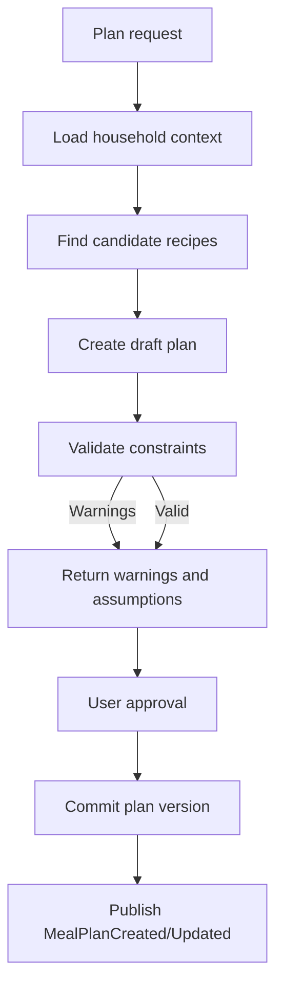

# Meal Planning Service Specification

**Status:** Draft  
**Component type:** C# / ASP.NET Core domain service

## Purpose

Create, store, validate, and edit meal plans for a household and date range.

## Responsibilities

- Create meal-plan drafts and committed plans.
- Assign recipes or meal concepts to dates and meal slots.
- Store plan constraints, serving counts, locked meals, and generation metadata.
- Support optional nutrition targets and limits using data from the Nutrition Data Service.
- Validate dietary, timing, pantry, and repetition constraints.
- Produce ingredient requirements for downstream shopping-list generation.

## Core entities

- `MealPlan`: household, date range, status, version, and constraints.
- `MealAssignment`: date, slot, recipe or concept, servings, and lock state.
- `PlanConstraint`: typed constraint and enforcement level.
- `PlanVersion`: draft, committed, superseded, or discarded.
- `NutritionSummary`: calculated plan totals, per-serving values, source coverage, and warnings.

## API

```text
GET    /api/v1/meal-plans
POST   /api/v1/meal-plans
GET    /api/v1/meal-plans/{planId}
PATCH  /api/v1/meal-plans/{planId}
POST   /api/v1/meal-plans/{planId}/assignments
PATCH  /api/v1/meal-plans/{planId}/assignments/{assignmentId}
POST   /api/v1/meal-plans/{planId}/commit
GET    /api/v1/meal-plans/{planId}/ingredients
```

## MCP capabilities

Resources:

- `meal-plans://current`
- `meal-plans://plan/{planId}`

Tools:

- `create_meal_plan_draft`
- `replace_meal_plan_meal`
- `validate_meal_plan`
- `calculate_plan_ingredients`
- `calculate_meal_plan_nutrition`
- `commit_meal_plan`

Draft creation and commit are separate operations. Commit requires an approval reference when initiated by an agent.

## Generation workflow



## Business rules

- Locked meals cannot be replaced by regeneration.
- Plans must report unsatisfied constraints rather than silently ignoring them.
- Nutrition summaries must show coverage and uncertainty; they must not imply medical suitability.
- A committed plan is versioned; edits create a new version.
- Ingredient totals must be reproducible from the committed assignments.

## Acceptance criteria

- A one-week plan can be drafted, reviewed, edited, and committed.
- The service identifies constraint conflicts and missing recipe data.
- A committed plan can produce a deterministic ingredient requirement set.
- A plan can show nutrition totals when sufficient source data exists and identify ingredients without coverage.
