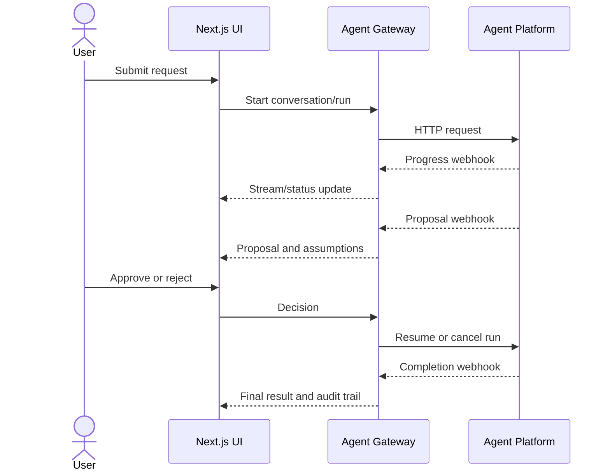

# Next.js Web App Specification

**Status:** Draft  
**Component type:** React / Next.js frontend

## Purpose

Provide the primary user interface for pantry management, shopping lists, meal planning, recipes, and conversations with the Dinner agent.

## Responsibilities

- Render household, pantry, recipe, shopping-list, and meal-plan views.
- Maintain local household/profile context.
- Call the Dinner API Gateway and Agent Gateway.
- Display AI proposals separately from committed data.
- Collect explicit approval for agent-proposed mutations.
- Show agent progress, assumptions, warnings, and failures.
- Provide accessible, responsive interactions for desktop and mobile browser sizes.

## Initial routes

| Route | Purpose |
| --- | --- |
| `/` | Dashboard with pantry alerts, current plan, and active lists |
| `/pantry` | Pantry inventory and item management |
| `/shopping` | Shopping lists and item completion |
| `/plan` | Meal-plan calendar and plan editing |
| `/recipes` | Recipe search and recipe detail |
| `/assistant` | Agent conversation and proposal review |
| `/activity` | Agent runs and action history |

## State and API rules

- Use typed clients generated from OpenAPI where available.
- Keep server data in query/mutation state, not duplicated across unrelated components.
- Treat draft, pending approval, committed, rejected, and failed as distinct states.
- Use optimistic updates only for reversible local actions such as checking a shopping item.
- Invalidate or refresh affected queries after service events or agent approvals.

## Agent interaction flow

## Non-functional requirements

- Support modern evergreen browsers.
- Provide keyboard navigation and useful screen-reader labels.
- Show an immediate acknowledgement for long-running agent operations.
- Do not expose service credentials or platform secrets to browser code.
- Capture frontend errors with correlation IDs that can be linked to backend traces.

## Acceptance criteria

- A user can add, edit, and consume a pantry item.
- A user can view, edit, and complete a shopping list item.
- A user can review and approve a meal-plan proposal.
- A user can see why an AI proposal was generated and what will change before approval.
