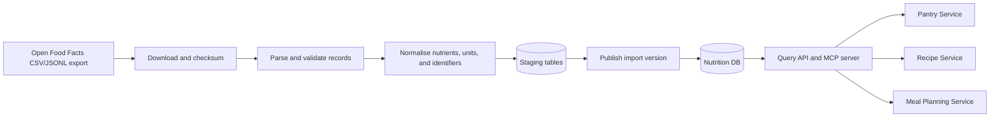

# Nutrition Data Service Specification

**Status:** Draft  
**Component type:** C# / ASP.NET Core data-ingestion and query service

## Purpose

Provide a local, searchable nutrition and packaged-food product projection for Dinner. The initial source is the Open Food Facts public dataset, with the service designed so additional nutrition sources can be added later.

## Responsibilities

- Download and import Open Food Facts CSV or JSONL bulk exports.
- Support resumable, repeatable imports with an import manifest.
- Store product identifiers, names, brands, categories, ingredients, allergens, labels, and nutrient values where available.
- Normalise nutrients and units into Dinner’s internal vocabulary.
- Preserve raw source values, serving basis, source version, and provenance.
- Resolve barcode and ingredient lookups for pantry, recipes, and meal plans.
- Expose nutrition context to the frontend and agent platform through MCP.

## Non-responsibilities

- It does not own household pantry quantities.
- It does not infer medical advice or diagnose dietary suitability.
- It does not treat missing nutrition values as zero.
- It does not download or redistribute product images in the MVP.

## Data model

- `FoodProduct`: source, barcode, product name, brands, categories, and locale.
- `NutrientValue`: nutrient key, value, unit, basis, and confidence.
- `IngredientDeclaration`: raw and normalised ingredient text.
- `AllergenDeclaration`: source allergen, normalised allergen, and confidence.
- `ImportManifest`: source URL, export date, checksum, started/completed times, and status.
- `ProductSourceRecord`: raw source fields retained for audit and reprocessing.

Nutrition values must distinguish at least:

- Value per 100 g or 100 ml.
- Value per serving where supplied.
- Unit and conversion status.
- Missing, estimated, or conflicting values.
- Source and import version.

## Ingestion architecture



The import must publish a complete version atomically from the perspective of readers. Failed or partial imports remain staged and must not replace the active version.

## API

```text
GET /api/v1/nutrition/products/{barcode}
GET /api/v1/nutrition/products?query={query}
GET /api/v1/nutrition/products/{barcode}/nutrients
GET /api/v1/nutrition/imports/latest
```

## MCP capabilities

Resources:

- `nutrition://product/{barcode}`
- `nutrition://ingredient/{canonicalIngredient}`

Tools:

- `lookup_food_product`
- `search_food_products`
- `get_nutrition_facts`
- `match_ingredient_to_food_product`

Nutrition lookup tools are read-only in the MVP.

## Open Food Facts operating rules

- Prefer bulk CSV or JSONL exports for large-scale ingestion.
- Use the API only for targeted product refreshes or small lookups.
- Use a descriptive User-Agent for requests.
- Respect the published API rate limits and avoid search-as-you-type traffic against the public API.
- Retain source attribution and ODbL/database-content licence metadata.
- Review the separate licence requirements before using product images.
- Treat the data as community-provided and potentially incomplete or inaccurate.

References: [data downloads](https://world.openfoodfacts.org/data), [API documentation](https://openfoodfacts.github.io/documentation/docs/Product-Opener/api/), [licensing guidance](https://openfoodfacts.github.io/documentation/docs/Product-Opener/api/tutorials/license-be-on-the-legal-side/).

## Acceptance criteria

- A development import can load a representative fixture without requiring the full dataset.
- An import can resume or restart safely after failure.
- The active nutrition projection is versioned and queryable by barcode and ingredient.
- Missing values remain distinguishable from zero values.
- API and MCP responses include provenance and serving basis.
- The service can be rebuilt from a documented Open Food Facts export and import version.
