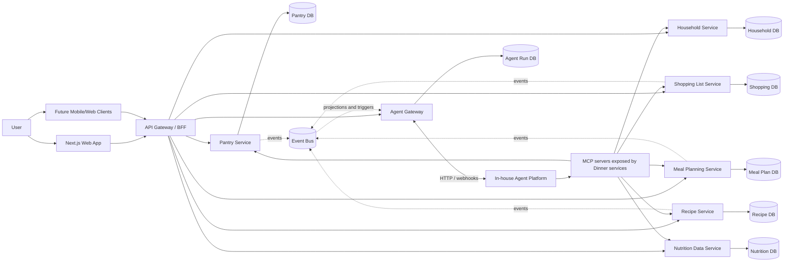
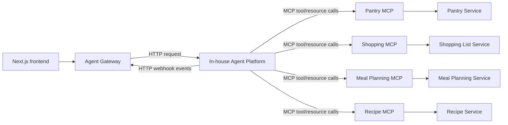
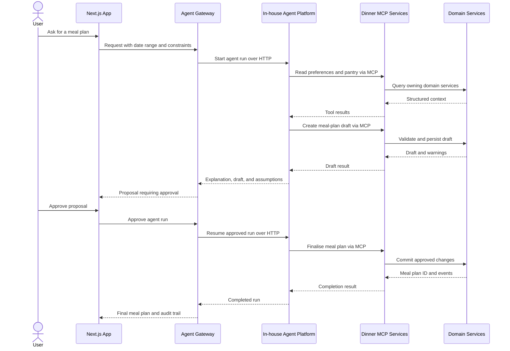
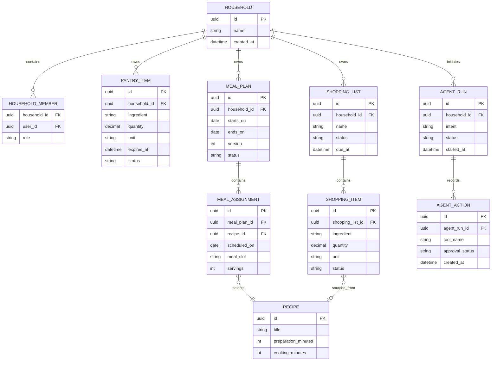

# Dinner — Product and Technical Specification

**Status:** Draft  
**Version:** 0.1  
**Last updated:** 2026-11-14

## 1. Overview

Dinner is an AI-assisted food application that helps people manage the food they have, decide what to buy, and plan what to eat. The product will use a microservices architecture, with backend services written in C# and web frontends built with React and Next.js.

LLMs will be a core part of the product rather than an incidental feature. Dinner will use the company’s in-house agent platform to interpret user intent, combine structured household data with recipes and preferences, propose plans, explain recommendations, and execute approved actions through controlled tools.

The first product capabilities are:

1. Managing a household pantry.
2. Producing and maintaining shopping lists.
3. Producing meal plans.

Open Food Facts will provide the initial external food-product and nutrition dataset. Dinner will ingest a local, curated projection of the data rather than query the public service for every user interaction. The source data is community-contributed, so nutrition values and product metadata must be treated as evidence with provenance and confidence, not as guaranteed truth.

## 2. Goals and non-goals

### Goals

- Make it quick to understand what food is available and what needs replenishing.
- Generate useful shopping lists from pantry state, meal plans, and user requests.
- Generate practical meal plans based on preferences, constraints, time, budget, and available ingredients.
- Make AI recommendations transparent, editable, and user-controlled.
- Establish service boundaries that allow individual capabilities to evolve independently.
- Keep critical food data structured and deterministic while using LLMs for interpretation and orchestration.

### Non-goals for the initial release

- Operating a grocery marketplace or placing orders directly with retailers.
- Providing medical diagnosis or personalised medical treatment.
- Fully autonomous purchasing without explicit user approval.
- Supporting every dietary, regional, or nutritional standard at launch.

## 3. Product concepts

### Household

A household is the primary tenant boundary. It contains members, pantry items, shopping lists, meal plans, recipes, preferences, and permissions.

### Pantry

The pantry represents food available to a household. Items may be tracked by quantity, unit, location, expiry date, freshness, category, and confidence of the recorded data.

### Shopping list

A shopping list is a user-editable collection of items to acquire. Items may originate from manual entry, pantry replenishment suggestions, or meal-plan requirements.

### Meal plan

A meal plan maps meals to dates and meal slots. It contains selected recipes or meal concepts, serving counts, ingredient requirements, and the reasoning or constraints used to create it.

### Agent run

An agent run is a traceable execution on the in-house agent platform. It records the user request, context references, tools invoked, proposed changes, approvals, results, and any errors. Agent runs must be auditable and replayable where practical.

### Food product and nutrition data

A food product is a packaged or generic food reference identified by a source identifier, such as a barcode or canonical ingredient key. Nutrition data contains nutrient values, units, serving basis, source, import version, and confidence. Product nutrition is separate from household pantry quantities so that the same product can be reused across households.

## 4. Primary user journeys

### 4.1 Manage pantry

The user can:

- Add, edit, consume, remove, or restore pantry items.
- Record quantities, units, locations, purchase dates, and expiry dates.
- Import items through a future receipt or barcode workflow.
- Ask the assistant questions such as “What can I make with the food I have?”
- Receive suggestions for expiring, missing, or low-stock items.

### 4.2 Produce a shopping list

The user can:

- Create a list manually.
- Ask Dinner to create a list from a meal plan.
- Ask Dinner to replenish low-stock or missing pantry staples.
- Combine duplicate ingredients and normalise units.
- Edit, check off, defer, or remove items.
- Review why an item was added and approve AI-proposed changes.

### 4.3 Produce a meal plan

The user can:

- Request a plan for a date range and number of people.
- Set constraints such as dietary preferences, allergies, disliked foods, budget, cooking time, and available equipment.
- Prefer recipes that use pantry items.
- Review, regenerate, swap, edit, or lock individual meals.
- Convert the final plan into a shopping list.

## 5. High-level architecture

The system is organised around domain services with asynchronous events for cross-service updates. The web clients communicate through an API gateway or backend-for-frontend layer. The in-house agent platform communicates with Dinner through HTTP/webhooks and accesses domain capabilities through MCP servers exposed by the Dinner services. The agent platform and MCP services never access Dinner databases directly.



## 6. Service boundaries

All backend services should be independently deployable C# services, preferably using ASP.NET Core. Each service owns its data and exposes capabilities through versioned APIs and integration events.

| Service | Responsibility | Initial data ownership |
| --- | --- | --- |
| Household Service | Local household/profile context, preferences, dietary constraints, permissions, and settings | Households, profiles, preferences |
| Pantry Service | Pantry items, quantities, locations, consumption, expiry, and stock state | Pantry items and pantry history |
| Recipe Service | Recipes, ingredients, tags, substitutions, preparation metadata, and search | Recipes and recipe metadata |
| Nutrition Data Service | Open Food Facts ingestion, product lookup, nutrient normalisation, provenance, and local nutrition projections | Imported product and nutrient records |
| Meal Planning Service | Meal-plan drafts, selected meals, constraints, servings, locks, and plan versions | Meal plans and meal assignments |
| Shopping List Service | Shopping lists, line items, units, grouping, completion, and list history | Shopping lists and shopping items |
| Agent Gateway | HTTP/webhook adapter between the web frontend and in-house agent platform; conversation context, approval requests, and run status | Conversations, agent runs, proposals, approvals |
| Notification Service | Email, push, and in-app notifications | Notification preferences and delivery records |

The Notification Service may be deferred until after the initial release. Search and analytics should initially be implemented within the owning service or as read models, rather than introducing a separate service without a clear need.

### Open Food Facts integration

The Nutrition Data Service will use Open Food Facts bulk exports for initial and periodic ingestion, and may use the product API for targeted lookups or refreshes. Bulk exports are preferred for large volumes; the Open Food Facts documentation advises downloading CSV or JSONL rather than issuing large numbers of API searches. The import pipeline must be resumable, versioned, and able to record the source export date.

The integration must:

- Store the Open Food Facts product code, source URL, import version, and source timestamp.
- Normalise nutrient names and units into Dinner’s internal nutrient vocabulary.
- Preserve original values and serving basis alongside normalised values.
- Record missing, estimated, or conflicting values rather than silently filling them.
- Use a descriptive User-Agent for any API requests and respect published rate limits.
- Keep Open Food Facts attribution and ODbL/database-content licence information with the imported projection and product documentation.
- Avoid redistributing product images until their separate image licensing requirements are reviewed.

Open Food Facts data is provided by contributors and is not guaranteed to be complete or accurate. Dinner must display nutrition as informational, avoid medical claims, and avoid presenting missing values as zero.

Reference documentation: [Open Food Facts data](https://world.openfoodfacts.org/data), [API documentation](https://openfoodfacts.github.io/documentation/docs/Product-Opener/api/), and [licensing guidance](https://openfoodfacts.github.io/documentation/docs/Product-Opener/api/tutorials/license-be-on-the-legal-side/).

## 7. Frontend architecture

The primary frontend is a React application built with Next.js.

- Use Next.js routing and server rendering where it improves initial load or search visibility.
- Use client components for interactive pantry, list, plan, and conversation experiences.
- Keep domain state behind typed API clients and query/mutation hooks.
- Treat agent proposals as a distinct UI state: proposed, awaiting approval, approved, rejected, applied, or failed.
- Provide optimistic updates only where conflict handling is well-defined.
- Make every AI-generated change explainable and reversible where possible.

Initial screens:

1. Household setup and preferences.
2. Pantry overview and pantry item editor.
3. Shopping lists and list-item management.
4. Meal-plan calendar and meal detail view.
5. Assistant conversation and approval panel.
6. Agent activity/history view.
7. Nutrition details on supported products, recipes, and meal plans.

## 8. LLM and agent platform integration

The in-house agent platform is the orchestration layer for natural-language interactions and multi-step AI workflows. The Agent Gateway communicates with it through the platform’s HTTP/webhooks interface. Dinner domain services expose MCP servers for the platform to discover and invoke. Domain services remain authoritative for validation, persistence, and business rules.

### Communication topology



The HTTP/webhook interface is the boundary for agent conversations and lifecycle events. MCP is the capability boundary for reading Dinner data and proposing or applying domain actions.

### Agent responsibilities

- Interpret natural-language requests.
- Resolve references such as “what I have” or “next week.”
- Retrieve relevant household, pantry, recipe, and plan context.
- Select and call MCP tools exposed by Dinner services.
- Generate candidate meal plans and shopping lists.
- Explain recommendations and identify assumptions.
- Ask clarifying questions when constraints conflict or data is missing.
- Present mutations as proposals requiring approval when they change user data.

### Domain tool principles

- MCP tools and resources are narrow, typed, versioned, and idempotent where practical.
- Read resources/tools and write tools are separate.
- Write tools validate permissions and domain invariants in the owning service.
- Agents never receive unrestricted database access.
- MCP calls include household/profile context, correlation ID, and agent-run ID.
- Tool results should include structured data plus human-readable summaries.
- Each MCP server must expose a health/readiness signal and a capability manifest suitable for agent-platform discovery.
- Destructive or externally consequential MCP tools must support explicit approval and replay-safe execution.

### Example tools

```text
get_pantry_items
find_recipes
get_household_preferences
create_meal_plan_draft
replace_meal_plan_meal
calculate_plan_ingredients
create_shopping_list_draft
merge_shopping_list_items
propose_pantry_updates
apply_approved_changes
```

### Agent workflow



## 9. Core domain model



## 10. API and integration conventions

- Frontend-to-Dinner APIs use HTTPS and JSON over REST initially.
- Agent Gateway-to-platform communication uses the in-house platform’s HTTP/webhooks contract.
- Dinner domain services expose MCP endpoints for agent-platform discovery and invocation.
- APIs are versioned, for example `/api/v1/pantry/items`.
- OpenAPI contracts are generated and checked into the service build pipeline.
- Use a correlation ID on every request and propagate it through events and agent runs.
- Use idempotency keys for mutation endpoints that may be retried.
- Use RFC 7807-style problem details for errors.
- Publish integration events using a versioned event envelope:

```json
{
  "eventType": "PantryItemUpdated.v1",
  "eventId": "uuid",
  "occurredAt": "2026-11-14T00:00:00Z",
  "householdId": "uuid",
  "correlationId": "uuid",
  "data": {}
}
```

Initial events may include:

- `PantryItemAdded.v1`
- `PantryItemConsumed.v1`
- `PantryItemExpiring.v1`
- `MealPlanCreated.v1`
- `MealPlanUpdated.v1`
- `ShoppingListCreated.v1`
- `ShoppingItemCompleted.v1`
- `AgentRunCompleted.v1`

## 11. Persistence and infrastructure

- Each service owns its PostgreSQL schema or database boundary.
- PostgreSQL is the initial relational datastore.
- Use migrations as part of each service’s deployment process.
- Use an event bus for asynchronous integration; the implementation is an infrastructure decision and may begin with a lightweight broker.
- Use object storage for images, receipts, and future document inputs.
- Use a dedicated vector or search capability only when the recipe and ingredient search requirements justify it.
- Local development should be runnable through Docker Compose, with PostgreSQL as the first infrastructure dependency.

## 12. Security, privacy, and safety

- Keep household/profile context on every service request and MCP call.
- Treat local development context as trusted only within the configured application boundary; do not expose the development instance publicly.
- Store secrets in environment-specific secret management systems; `.env` files are for local development only.
- Encrypt data in transit and at rest where supported by the deployment environment.
- Minimise personal data sent to LLM providers or the in-house agent platform.
- Record model, prompt/template, tool, and policy versions for every agent run.
- Require explicit approval for destructive or externally consequential actions.
- Treat allergies and dietary restrictions as high-priority constraints, but display a clear disclaimer that Dinner is not a substitute for professional medical advice.
- Redact secrets and sensitive personal data from logs and traces.

## 13. Reliability and observability

- Health and readiness endpoints for every service.
- Structured logs with correlation ID, household ID, request ID, and agent-run ID where applicable.
- Metrics for request latency, error rate, event lag, agent latency, tool failures, approval conversion, and recommendation acceptance.
- Distributed tracing across frontend gateway, services, event bus, and agent platform.
- Retries with backoff for transient external calls; no blind retries for non-idempotent mutations.
- Dead-letter handling and replay procedures for failed events.
- Agent runs must expose a user-friendly failure state and a support-debuggable technical trace.

## 14. Quality requirements

### Functional quality

- Pantry quantities and units must be normalised consistently enough to calculate recipe and shopping requirements.
- Meal-plan generation must identify unmet constraints instead of silently violating them.
- Shopping-list generation must avoid duplicate items where ingredient identity and units can be safely reconciled.
- Every AI-generated mutation must be attributable to an agent run and user approval state.

### Performance targets for the initial release

These are starting targets and should be validated with real usage:

- Typical read API response: p95 under 500 ms.
- Typical mutation API response: p95 under 800 ms, excluding asynchronous work.
- Initial assistant response: visible progress or acknowledgement within 2 seconds.
- Common meal-plan generation: completed within 30 seconds for a one-week plan, or provide incremental progress.
- The web application should meet agreed Core Web Vitals targets on supported modern browsers.

## 15. Delivery plan

### Phase 1 — Foundation

- Repository and service templates for C# ASP.NET Core.
- Next.js application shell and local household/profile context.
- Docker Compose PostgreSQL development environment.
- Household service.
- CI pipeline, migrations, health checks, logging, and tracing baseline.

### Phase 2 — Pantry

- Pantry CRUD and consumption flows.
- Ingredient and unit normalisation.
- Expiry and low-stock views.
- First read-only agent tools for pantry queries.

### Phase 3 — Shopping lists

- Manual lists and item completion.
- Pantry replenishment suggestions.
- Meal-plan-to-shopping-list calculation.
- AI-generated list proposals with approval.

### Phase 4 — Meal planning

- Recipe catalogue and search.
- Constraint-aware meal-plan drafts.
- Calendar editing, meal swaps, and plan versioning.
- Agent explanations, regeneration, and approval flow.

### Phase 5 — Hardening

- Notifications, imports, richer analytics, performance tuning, disaster recovery, and production operations.

## 16. Open decisions

1. What is the initial event-bus technology and hosting model?
2. Which in-house agent platform HTTP/webhook APIs, MCP registration mechanisms, models, guardrails, and evaluation tools are available?
3. Will recipes be authored internally, imported, licensed, or user-generated?
4. Which units, locales, currencies, and regional food conventions are required at launch?
5. What are the household sharing and role-permission requirements within the local application context?
6. Which AI actions require approval, and which low-risk actions may be automatically applied?
7. What is the production deployment target and service orchestration platform?

## 17. Definition of done for the first vertical slice

The first end-to-end slice is complete when a user can:

1. Create or join a household.
2. Add pantry items with quantity and expiry data.
3. Ask the Dinner assistant for meal suggestions using those pantry items.
4. Review and approve a generated meal-plan draft.
5. Generate a shopping-list draft from the approved plan.
6. Edit and complete shopping-list items.
7. Inspect the agent run, tool actions, assumptions, and approval history.

Every step must be covered by automated tests at the domain and API layers, with at least one browser-level happy-path test for the vertical slice.
