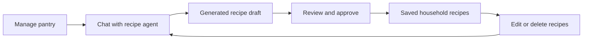
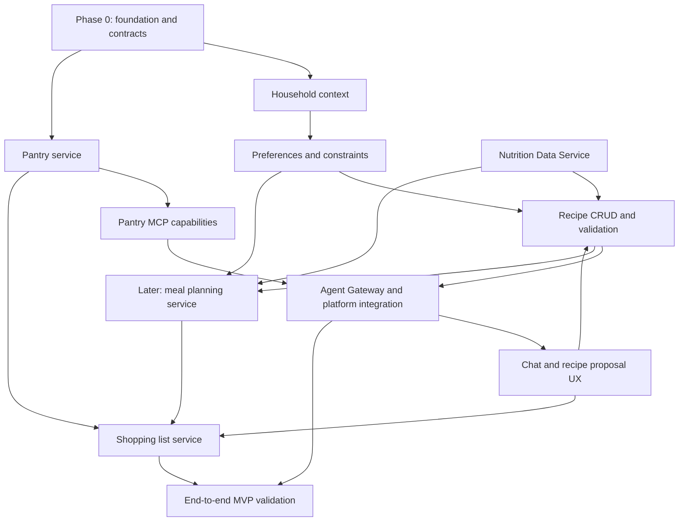

# Dinner MVP Delivery Plan

**Status:** Draft  
**Version:** 0.1  
**Last updated:** 2026-11-14

## 1. Objective

Deliver the first usable Dinner release in which a user can manage pantry items and use a chat interface backed by the in-house agent platform to generate, review, save, edit, and delete household recipes.

The MVP should prove the complete product loop:

## 2. MVP scope

### Included

- Local household/profile context without authentication.
- Pantry item CRUD, consumption, expiry, and low-stock views.
- A household recipe collection with manual and agent-assisted CRUD.
- A chat interface for recipe generation, refinement, and recipe-management requests.
- A local nutrition-data projection seeded from an Open Food Facts fixture or representative export subset.
- Nutrition lookup and provenance on supported food products and recipe ingredients.
- Recipe drafts with structured ingredients, servings, instructions, tags, and source/agent-run attribution.
- Explicit confirmation before an agent creates, overwrites, or deletes a saved recipe.
- Agent conversations through the Agent Gateway.
- HTTP/webhook communication with the in-house agent platform.
- MCP resources and tools exposed by Dinner domain services.
- Agent-run history, proposals, approvals, and failures.
- Docker Compose local infrastructure with PostgreSQL.
- Automated domain, API, MCP, integration, and browser happy-path tests.

### Explicitly out of scope

- Authentication and external identity providers.
- Grocery retailer integrations or automatic purchasing.
- Receipt scanning, barcode scanning, and image recognition.
- Mobile-native applications.
- Push notifications and email delivery.
- Advanced nutrition calculation or medical dietary advice.
- Full production-scale Open Food Facts ingestion and product-image redistribution.
- Multi-region deployment and production-scale tenancy.
- Fully autonomous write actions without confirmation.

## 3. Delivery principles

- Deliver one end-to-end vertical slice before expanding feature breadth.
- Keep domain services authoritative for validation and persistence.
- Use the agent platform for interpretation and orchestration, not database access.
- Expose agent capabilities through typed MCP resources and tools.
- Make every AI-generated mutation visible, reviewable, and attributable.
- Prefer simple local infrastructure and explicit contracts over premature platform complexity.
- Keep all service APIs, MCP contracts, and events versioned.

## 4. Target component set

| Component | MVP responsibility | Priority |
| --- | --- | --- |
| Next.js Web App | Pantry, recipe-chat workspace, recipe editor, proposal review, and status display | Must have |
| Household Service | Local profile, preferences, and constraints | Must have |
| Pantry Service | Inventory and stock context | Must have |
| Recipe Service | Household recipe CRUD, versioning, search, and generated-draft validation | Must have |
| Nutrition Data Service | Local Open Food Facts projection and nutrition lookups | Must have |
| Meal Planning Service | Deferred follow-on capability | Later |
| Shopping List Service | Deferred follow-on capability | Later |
| Agent Gateway | HTTP/webhook boundary and run audit | Must have |
| Notification Service | Deferred; in-app status is handled by the frontend and Agent Gateway | Not MVP |

## 5. Delivery phases

### Phase 0 — Alignment and skeleton

**Outcome:** The team can run the system locally and agree on contracts.

Work:

- Confirm MVP decisions and sample user journey.
- Create solution structure for C# services.
- Create Next.js application shell.
- Add Docker Compose PostgreSQL setup and environment configuration.
- Add shared conventions for logging, correlation IDs, errors, and migrations.
- Define initial OpenAPI contracts and MCP capability manifests.
- Define agent-platform HTTP/webhook assumptions with test fixtures.

Exit criteria:

- All components build locally.
- PostgreSQL starts through `run.sh`.
- A service health endpoint and frontend shell are available.
- A mocked agent-platform webhook can be received by the Agent Gateway.

### Phase 1 — Household and pantry vertical slice

**Outcome:** A user can create local household context and manage pantry inventory.

Work:

- Implement Household Service profile and preference model.
- Implement Pantry Service item and adjustment model.
- Add pantry CRUD, consume, restore, expiry, and low-stock APIs.
- Add household and pantry MCP resources/tools.
- Build pantry screens and basic dashboard.
- Add seed data for ingredients and a sample household.
- Add barcode/product-reference fields without requiring a barcode workflow.

Exit criteria:

- A user can add, edit, consume, and restore pantry items.
- Pantry quantities and units are validated.
- Agent tools can answer what is available and what is expiring.
- Domain and API tests cover the main inventory rules.

### Phase 2 — Chat-driven recipe workspace

**Outcome:** A user can ask the agent to create or change a recipe and explicitly save the result to their household recipe collection.

Work:

- Implement Recipe Service household ownership, CRUD, draft/version, ingredient, and source-attribution model.
- Implement Nutrition Data Service with a representative Open Food Facts fixture, import manifest, nutrient normalisation, and provenance.
- Add recipe search by ingredient, time, meal type, and dietary tags, scoped to a household.
- Link recipe ingredients to nutrition references where available.
- Add recipe MCP read tools plus draft/create/update/delete proposal tools.
- Add nutrition MCP resources and read-only lookup tools.
- Implement Agent Gateway conversation/thread creation, timeline reconciliation, and progress state.
- Connect the Agent Gateway to the in-house platform HTTP/webhook contract.
- Build an assistant chat, generated-recipe draft, recipe editor, and deletion-confirmation UI.

Exit criteria:

- The agent can use pantry context and household preferences to generate a structured recipe draft.
- A recipe can display nutrition values when source coverage exists.
- Missing or conflicting constraints are shown to the user before save.
- The user can edit a generated draft, approve a create/update, or reject it; deletion requires an explicit confirmation.
- The platform can invoke the configured Dinner MCP recipe capabilities.

### Phase 3 — Meal planning and shopping-list loop

**Outcome:** Saved recipes can be assembled into a meal plan and then produce a useful editable shopping list.

Work:

- Implement Meal Planning Service draft, assignment, validation, and versioning using saved recipes.
- Implement Shopping List Service item and list lifecycle.
- Calculate required ingredients from a committed meal plan.
- Subtract compatible pantry stock.
- Merge duplicate compatible ingredients.
- Preserve source links to meal plans and pantry calculations.
- Preserve nutrition source/version metadata when nutrition is shown in the plan.
- Add shopping-list MCP tools.
- Build shopping-list editing and completion UI.

Exit criteria:

- An approved meal plan creates a shopping-list draft.
- Duplicate items are merged with explainable quantities.
- The user can edit, remove, defer, and complete items.
- The complete loop is covered by a browser-level test.

### Phase 4 — Hardening and MVP release

**Outcome:** The complete workflow is reliable enough for regular project use.

Work:

- Add complete agent-run timeline and error states.
- Add idempotency and replay protection for webhooks and write tools.
- Add structured logs, metrics, and correlation IDs.
- Add migration and seed-data commands.
- Add backup and reset instructions for local PostgreSQL data.
- Run contract, integration, failure-path, and browser tests.
- Document known limitations and operational recovery steps.
- Document the Open Food Facts attribution, licence, source-version, and refresh process.

Exit criteria:

- No open critical defects in the main vertical slice.
- All must-have acceptance criteria pass.
- A fresh checkout can be started using the documented commands.
- Agent failures do not leave partially committed domain changes.

## 6. Delivery dependency graph

## 7. Workstream plan

### Backend services

- C# solution and service templates.
- PostgreSQL schema and migrations per service.
- REST endpoints and OpenAPI documents.
- Domain validation and idempotent command handlers.
- Integration events and correlation metadata.
- MCP server hosting, capability discovery, and tool schemas.

### Agent integration

- Agent Gateway HTTP client for run creation and resumption.
- Webhook receiver with signature validation placeholder, replay protection, and idempotency.
- Agent-run persistence and state machine.
- MCP server registry/configuration.
- Proposal and approval protocol.
- Mock platform adapter for local and automated tests.

### Frontend

- Application shell and local household setup.
- Pantry list, editor, and alerts.
- Recipe chat, generated-recipe draft, and recipe editor views.
- Deletion confirmation and recipe version/conflict states.
- Meal-plan calendar and shopping-list editor (Phase 3).
- Agent progress, clarification, approval, and failure states.

### Quality and operations

- Unit and domain tests on every service.
- API contract tests from OpenAPI.
- MCP capability and tool invocation tests.
- Integration tests with PostgreSQL and a mock agent platform.
- Browser test for the full pantry-to-chat-to-saved-recipe flow.
- Structured logs, health checks, and local troubleshooting documentation.

## 8. Proposed backlog by milestone

### M0 — Buildable skeleton

- [x] Create C# solution and service project templates.
- [x] Create Next.js application shell.
- [x] Verify Docker Compose PostgreSQL workflow.
- [x] Add shared configuration and environment conventions.
- [x] Add health endpoints.
- [x] Define API, event, and MCP naming conventions.

### M1 — Pantry usable

- [x] Implement household/profile persistence.
- [x] Implement pantry item persistence and migrations.
- [x] Implement pantry CRUD and adjustment endpoints.
- [x] Add unit normalisation for MVP units.
- [x] Add expiry and low-stock queries.
- [x] Add pantry MCP resources and tools.
- [x] Build pantry UI and seed data.
- [x] Add optional pantry-to-food-product linking.

### M2 — Agent recipe chat usable

- [x] Implement household-scoped recipe persistence, CRUD, revisions, and source attribution.
- [x] Implement structured recipe-draft validation for ingredients, servings, instructions, tags, and unresolved ingredients.
- [x] Implement nutrition import fixture, local product lookup, normalisation, provenance, and recipe links.
- [x] Implement Agent Gateway conversation/thread lifecycle against the platform timeline API.
- [x] Implement signed webhook storage, deduplication, and timeline reconciliation.
- [x] Add recipe MCP resources and typed read/draft/create/update/delete proposal tools.
- [x] Add read-only nutrition MCP tools.
- [x] Build assistant chat, draft review, recipe editor, and explicit deletion confirmation UI.
- [ ] Add an end-to-end test: pantry context → chat-generated recipe → approve → edit → delete.

### M3 — Meal planning and shopping loop usable

- [ ] Implement meal-plan persistence, drafts, assignments, constraints, and versions.
- [ ] Add meal-plan MCP tools and calendar UI using saved household recipes.
- [ ] Implement shopping-list persistence and migrations.
- [ ] Implement plan ingredient calculation.
- [ ] Implement pantry subtraction and ingredient merging.
- [ ] Add shopping-list MCP tools.
- [ ] Build shopping-list UI.
- [ ] Add complete vertical-slice browser test.

### M4 — Release candidate

- [ ] Add failure recovery and idempotency tests.
- [ ] Add observability and run-history UI.
- [ ] Review data reset and migration procedures.
- [ ] Fix critical usability and accessibility issues.
- [ ] Publish local setup and troubleshooting documentation.
- [ ] Document Open Food Facts attribution, licence, and data refresh process.
- [ ] Run MVP acceptance review.

## 9. Agent and MCP contract milestones

The agent integration must be developed against a stable test contract even if the in-house platform is still evolving.

### Minimum platform contract

- Start a platform thread with the user prompt and persist its thread ID against the Dinner conversation/run.
- Treat the platform timeline as the source of truth and persist the highest processed sequence number.
- Send follow-ups with `Queued` or `Steering` delivery semantics; do not submit a second queued message while one is pending.
- Receive and verify signed `agent.message` and `agent.tool_call` webhooks using their raw request body, then deduplicate by event ID.
- Reconcile missed or out-of-order webhook events through the timeline endpoint.
- Keep recipe approval inside Dinner: after approval, execute the recipe domain command with the approval reference rather than trusting model text as a committed mutation.

### Minimum MCP contract

- Capability discovery.
- Structured input and output schemas.
- Read resources for household, pantry, recipes, and meal plans.
- Draft-producing recipe tools separated from approval-gated commit tools.
- Error codes that distinguish validation, permission, conflict, and transient failure.
- Idempotency key support for write operations.

## 10. Testing strategy

| Layer | Coverage |
| --- | --- |
| Domain unit tests | Quantities, recipe validation, revisions, constraints, merging, and approval rules |
| API tests | Request validation, response schemas, errors, and persistence behavior |
| MCP contract tests | Capability discovery, schemas, tool authorization context, and idempotency |
| Integration tests | Service plus PostgreSQL, events, and mock agent platform |
| Frontend tests | Forms, proposal states, loading/error states, and key interactions |
| Browser test | Pantry item → agent recipe chat → approval → edit → delete |
| Failure tests | Webhook retry, duplicate event, tool timeout, invalid recipe draft, stale revision, and partial failure |

The browser test should use deterministic recipe and agent fixtures so that it validates the product flow without depending on live model output.

## 11. MVP acceptance criteria

The MVP is accepted when all of the following are true:

1. A fresh local environment starts with the documented setup command.
2. A user can create local household/profile context.
3. A user can add pantry items with quantity, unit, and expiry.
4. The agent can retrieve pantry and preference context through MCP.
5. The user can use chat to request a recipe and receive a structured draft from the platform agent.
6. The user can inspect ingredients, assumptions, warnings, and proposed changes before saving.
7. The user can create, edit, and explicitly confirm deletion of a household recipe; agent-originated writes use a valid approval reference.
8. Agent runs, timeline entries, tool calls, approvals, and failures are traceable.
9. Nutrition values expose their serving basis, provenance, and missing-data state.
10. The MVP does not present Open Food Facts data as medical advice or guaranteed accuracy.

## 12. Risks and mitigations

| Risk | Impact | Mitigation |
| --- | --- | --- |
| Agent platform contract changes | Integration delay | Build against a mock contract and version the adapter |
| LLM output is inconsistent | Invalid or misleading recipes | Require structured recipe drafts, domain validation, and approval |
| Agent overwrite/delete request is ambiguous | Loss of a household recipe | Present the identified recipe, changed fields, and explicit confirmation before mutation |
| Ingredient and unit ambiguity | Incorrect shopping quantities | Start with a small canonical vocabulary and expose assumptions |
| Nutrition data is incomplete or inconsistent | Misleading meal summaries | Preserve provenance, show coverage, and never convert missing values to zero |
| Full Open Food Facts export is large | Slow or fragile local setup | Use a fixture/subset for MVP and run full ingestion as a separate repeatable job |
| External data licence misunderstood | Compliance risk | Store attribution/licence metadata and review ODbL/database-content requirements |
| Cross-service complexity slows delivery | MVP delay | Keep the vertical slice small and defer notifications/imports |
| Webhook duplication or replay | Duplicate mutations | Idempotency keys, event IDs, and persisted processing state |
| Partial agent failure | Confusing user experience | Separate drafts from commits and provide recoverable run states |
| Scope expands into nutrition or retail | Delivery distraction | Keep those capabilities explicitly out of MVP scope |

## 13. Release checklist

- [ ] `run.sh` starts the local infrastructure.
- [ ] `.env.example` documents required local settings.
- [ ] All migrations run from an empty database.
- [ ] Seed data supports the happy path.
- [ ] Nutrition fixture import succeeds and records its source version.
- [ ] API and MCP contracts are versioned.
- [ ] Webhook retries and duplicates are tested.
- [ ] Agent recipe-create/update/delete confirmation is tested.
- [ ] Pantry-to-chat-to-saved-recipe browser test passes.
- [ ] Known limitations are documented.
- [ ] Reset, backup, and troubleshooting instructions are documented.
