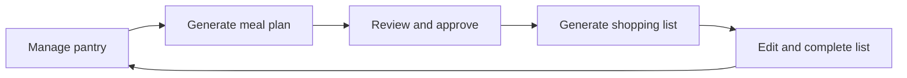
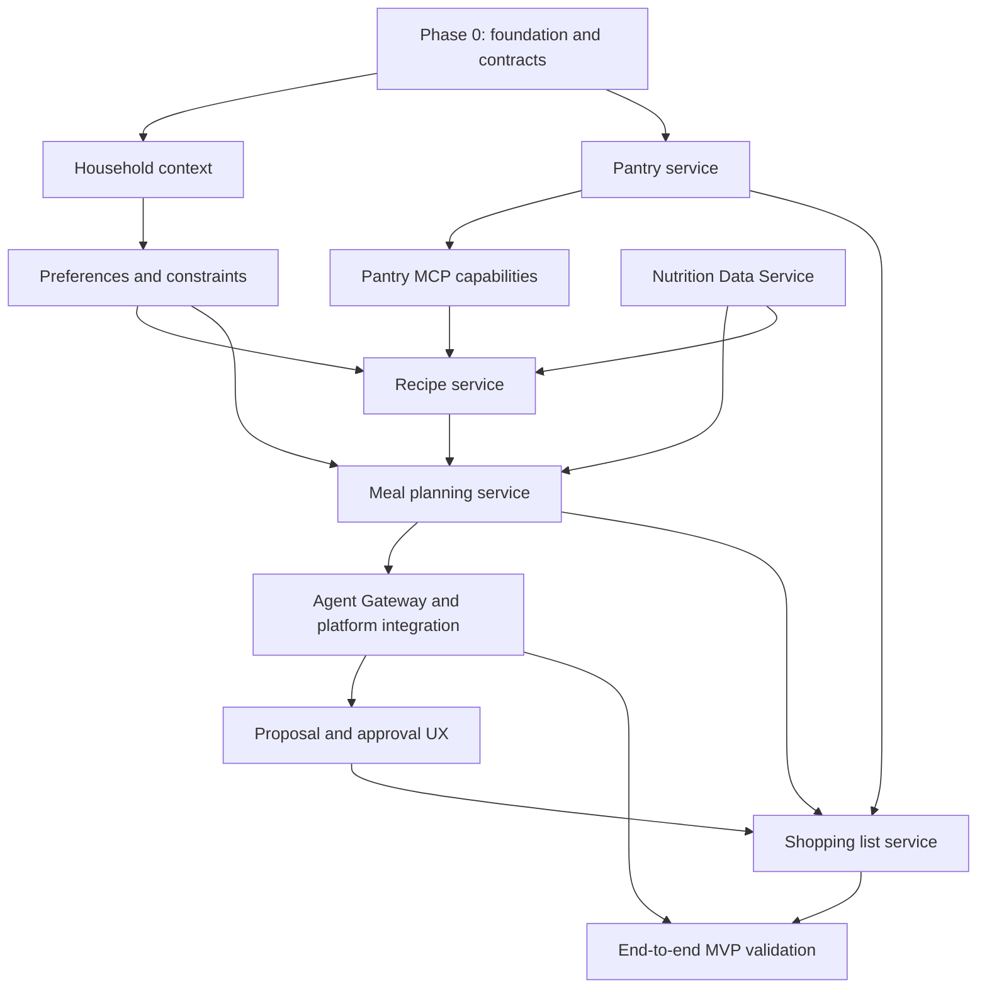

# Dinner MVP Delivery Plan

**Status:** Draft  
**Version:** 0.1  
**Last updated:** 2026-11-14

## 1. Objective

Deliver the first usable Dinner release in which a user can manage pantry items, ask the in-house agent for a meal plan, approve the result, and generate an editable shopping list from that plan.

The MVP should prove the complete product loop:

## 2. MVP scope

### Included

- Local household/profile context without authentication.
- Pantry item CRUD, consumption, expiry, and low-stock views.
- A small structured recipe catalogue.
- A local nutrition-data projection seeded from an Open Food Facts fixture or representative export subset.
- Nutrition lookup and provenance on supported food products and recipe ingredients.
- One-week meal-plan drafts with serving count and basic constraints.
- Review, edit, approve, and commit meal-plan drafts.
- Shopping-list generation from an approved meal plan.
- Manual shopping-list editing and item completion.
- Agent conversations through the Agent Gateway.
- HTTP/webhook communication with the in-house agent platform.
- MCP resources and tools exposed by Dinner domain services.
- Agent-run history, proposals, approvals, and failures.
- Docker Compose local infrastructure with PostgreSQL.
- Automated domain, API, MCP, integration, and browser happy-path tests.

### Explicitly out of scope

- Authentication and external identity providers.
- Grocery retailer integrations or automatic purchasing.
- Receipt scanning, barcode scanning, and image recognition.
- Mobile-native applications.
- Push notifications and email delivery.
- Advanced nutrition calculation or medical dietary advice.
- Full production-scale Open Food Facts ingestion and product-image redistribution.
- Multi-region deployment and production-scale tenancy.
- Fully autonomous write actions without approval.

## 3. Delivery principles

- Deliver one end-to-end vertical slice before expanding feature breadth.
- Keep domain services authoritative for validation and persistence.
- Use the agent platform for interpretation and orchestration, not database access.
- Expose agent capabilities through typed MCP resources and tools.
- Make every AI-generated mutation visible, reviewable, and attributable.
- Prefer simple local infrastructure and explicit contracts over premature platform complexity.
- Keep all service APIs, MCP contracts, and events versioned.

## 4. Target component set

| Component | MVP responsibility | Priority |
| --- | --- | --- |
| Next.js Web App | User workflows, proposal review, and status display | Must have |
| Household Service | Local profile, preferences, and constraints | Must have |
| Pantry Service | Inventory and stock context | Must have |
| Recipe Service | Small searchable recipe catalogue | Must have |
| Nutrition Data Service | Local Open Food Facts projection and nutrition lookups | Must have |
| Meal Planning Service | Draft, validate, edit, and commit meal plans | Must have |
| Shopping List Service | Generate, edit, and complete lists | Must have |
| Agent Gateway | HTTP/webhook boundary and run audit | Must have |
| Notification Service | Deferred; in-app status is handled by the frontend and Agent Gateway | Not MVP |

## 5. Delivery phases

### Phase 0 — Alignment and skeleton

**Outcome:** The team can run the system locally and agree on contracts.

Work:

- Confirm MVP decisions and sample user journey.
- Create solution structure for C# services.
- Create Next.js application shell.
- Add Docker Compose PostgreSQL setup and environment configuration.
- Add shared conventions for logging, correlation IDs, errors, and migrations.
- Define initial OpenAPI contracts and MCP capability manifests.
- Define agent-platform HTTP/webhook assumptions with test fixtures.

Exit criteria:

- All components build locally.
- PostgreSQL starts through `run.sh`.
- A service health endpoint and frontend shell are available.
- A mocked agent-platform webhook can be received by the Agent Gateway.

### Phase 1 — Household and pantry vertical slice

**Outcome:** A user can create local household context and manage pantry inventory.

Work:

- Implement Household Service profile and preference model.
- Implement Pantry Service item and adjustment model.
- Add pantry CRUD, consume, restore, expiry, and low-stock APIs.
- Add household and pantry MCP resources/tools.
- Build pantry screens and basic dashboard.
- Add seed data for ingredients and a sample household.
- Add barcode/product-reference fields without requiring a barcode workflow.

Exit criteria:

- A user can add, edit, consume, and restore pantry items.
- Pantry quantities and units are validated.
- Agent tools can answer what is available and what is expiring.
- Domain and API tests cover the main inventory rules.

### Phase 2 — Recipes and meal-plan generation

**Outcome:** A user can generate and review a constrained meal-plan draft.

Work:

- Implement Recipe Service catalogue and ingredient model.
- Implement Nutrition Data Service with a representative Open Food Facts fixture, import manifest, nutrient normalisation, and provenance.
- Add recipe search by ingredient, time, meal type, and dietary tags.
- Link recipe ingredients to nutrition references where available.
- Implement Meal Planning Service draft, assignment, validation, and versioning.
- Add recipe and meal-planning MCP resources/tools.
- Add nutrition MCP resources and read-only lookup tools.
- Implement Agent Gateway run creation and progress state.
- Connect the Agent Gateway to the in-house platform HTTP/webhook contract.
- Build meal-plan calendar and proposal review UI.

Exit criteria:

- A one-week draft can use pantry context and household preferences.
- A meal or recipe can display nutrition values when source coverage exists.
- Conflicting or unmet constraints are shown to the user.
- The user can swap a meal, lock a meal, and approve a draft.
- The platform can invoke Dinner MCP capabilities through the configured interface.

### Phase 3 — Shopping-list loop

**Outcome:** An approved meal plan produces a useful editable shopping list.

Work:

- Implement Shopping List Service item and list lifecycle.
- Calculate required ingredients from a committed meal plan.
- Subtract compatible pantry stock.
- Merge duplicate compatible ingredients.
- Preserve source links to meal plans and pantry calculations.
- Preserve nutrition source/version metadata when nutrition is shown in the plan.
- Add shopping-list MCP tools.
- Build shopping-list editing and completion UI.

Exit criteria:

- An approved meal plan creates a shopping-list draft.
- Duplicate items are merged with explainable quantities.
- The user can edit, remove, defer, and complete items.
- The complete loop is covered by a browser-level test.

### Phase 4 — Hardening and MVP release

**Outcome:** The complete workflow is reliable enough for regular project use.

Work:

- Add complete agent-run timeline and error states.
- Add idempotency and replay protection for webhooks and write tools.
- Add structured logs, metrics, and correlation IDs.
- Add migration and seed-data commands.
- Add backup and reset instructions for local PostgreSQL data.
- Run contract, integration, failure-path, and browser tests.
- Document known limitations and operational recovery steps.
- Document the Open Food Facts attribution, licence, source-version, and refresh process.

Exit criteria:

- No open critical defects in the main vertical slice.
- All must-have acceptance criteria pass.
- A fresh checkout can be started using the documented commands.
- Agent failures do not leave partially committed domain changes.

## 6. Delivery dependency graph

## 7. Workstream plan

### Backend services

- C# solution and service templates.
- PostgreSQL schema and migrations per service.
- REST endpoints and OpenAPI documents.
- Domain validation and idempotent command handlers.
- Integration events and correlation metadata.
- MCP server hosting, capability discovery, and tool schemas.

### Agent integration

- Agent Gateway HTTP client for run creation and resumption.
- Webhook receiver with signature validation placeholder, replay protection, and idempotency.
- Agent-run persistence and state machine.
- MCP server registry/configuration.
- Proposal and approval protocol.
- Mock platform adapter for local and automated tests.

### Frontend

- Application shell and local household setup.
- Pantry list, editor, and alerts.
- Recipe search and detail views.
- Meal-plan calendar and proposal review.
- Shopping-list editor and completion flow.
- Agent progress, clarification, approval, and failure states.

### Quality and operations

- Unit and domain tests on every service.
- API contract tests from OpenAPI.
- MCP capability and tool invocation tests.
- Integration tests with PostgreSQL and a mock agent platform.
- Browser test for the full pantry-to-plan-to-shopping flow.
- Structured logs, health checks, and local troubleshooting documentation.

## 8. Proposed backlog by milestone

### M0 — Buildable skeleton

- [x] Create C# solution and service project templates.
- [x] Create Next.js application shell.
- [x] Verify Docker Compose PostgreSQL workflow.
- [x] Add shared configuration and environment conventions.
- [x] Add health endpoints.
- [x] Define API, event, and MCP naming conventions.

### M1 — Pantry usable

- [x] Implement household/profile persistence.
- [x] Implement pantry item persistence and migrations.
- [x] Implement pantry CRUD and adjustment endpoints.
- [x] Add unit normalisation for MVP units.
- [x] Add expiry and low-stock queries.
- [x] Add pantry MCP resources and tools.
- [x] Build pantry UI and seed data.
- [x] Add optional pantry-to-food-product linking.

### M2 — Agent meal planning usable

- [x] Implement recipe catalogue and search.
- [x] Implement nutrition import fixture and local product lookup.
- [x] Add nutrient normalisation and provenance fields.
- [x] Link recipe ingredients to nutrition references where available.
- [x] Implement meal-plan draft and version model.
- [x] Implement constraint validation.
- [x] Implement Agent Gateway run state machine.
- [x] Implement HTTP request and webhook fixtures.
- [x] Add recipe and meal-plan MCP tools.
- [x] Add read-only nutrition MCP tools.
- [x] Build meal-plan review and approval UI.

### M3 — Shopping loop usable

- [ ] Implement shopping-list persistence and migrations.
- [ ] Implement plan ingredient calculation.
- [ ] Implement pantry subtraction and ingredient merging.
- [ ] Add shopping-list MCP tools.
- [ ] Build shopping-list UI.
- [ ] Add complete vertical-slice browser test.

### M4 — Release candidate

- [ ] Add failure recovery and idempotency tests.
- [ ] Add observability and run-history UI.
- [ ] Review data reset and migration procedures.
- [ ] Fix critical usability and accessibility issues.
- [ ] Publish local setup and troubleshooting documentation.
- [ ] Document Open Food Facts attribution, licence, and data refresh process.
- [ ] Run MVP acceptance review.

## 9. Agent and MCP contract milestones

The agent integration must be developed against a stable test contract even if the in-house platform is still evolving.

### Minimum platform contract

- Start a run with a conversation, request, household context, and MCP server set.
- Return run ID and initial status.
- Emit progress, clarification, proposal, completion, and failure webhooks.
- Resume a paused run after approval.
- Cancel or reject a run.
- Include event ID, run ID, correlation ID, and event timestamp in every webhook.

### Minimum MCP contract

- Capability discovery.
- Structured input and output schemas.
- Read resources for household, pantry, recipes, and meal plans.
- Draft-producing tools separated from commit tools.
- Error codes that distinguish validation, permission, conflict, and transient failure.
- Idempotency key support for write operations.

## 10. Testing strategy

| Layer | Coverage |
| --- | --- |
| Domain unit tests | Quantities, units, constraints, versioning, merging, and approval rules |
| API tests | Request validation, response schemas, errors, and persistence behavior |
| MCP contract tests | Capability discovery, schemas, tool authorization context, and idempotency |
| Integration tests | Service plus PostgreSQL, events, and mock agent platform |
| Frontend tests | Forms, proposal states, loading/error states, and key interactions |
| Browser test | Pantry item → agent meal plan → approval → shopping list |
| Failure tests | Webhook retry, duplicate event, tool timeout, invalid proposal, and partial failure |

The browser test should use deterministic recipe and agent fixtures so that it validates the product flow without depending on live model output.

## 11. MVP acceptance criteria

The MVP is accepted when all of the following are true:

1. A fresh local environment starts with the documented setup command.
2. A user can create local household/profile context.
3. A user can add pantry items with quantity, unit, and expiry.
4. The agent can retrieve pantry and preference context through MCP.
5. The agent can produce a one-week meal-plan draft.
6. The user can inspect assumptions, warnings, and proposed changes.
7. The user can edit or reject the proposal before committing it.
8. The approved plan can produce a shopping-list draft.
9. The shopping list accounts for compatible pantry stock.
10. The user can edit and complete shopping-list items.
11. Agent runs, tool calls, approvals, and failures are traceable.
12. No critical data mutation occurs without a valid domain command and, for agent writes, an approval reference.
13. Nutrition values expose their serving basis, provenance, and missing-data state.
14. The MVP does not present Open Food Facts data as medical advice or guaranteed accuracy.

## 12. Risks and mitigations

| Risk | Impact | Mitigation |
| --- | --- | --- |
| Agent platform contract changes | Integration delay | Build against a mock contract and version the adapter |
| LLM output is inconsistent | Unreliable plans or lists | Require structured outputs, domain validation, and approval |
| Ingredient and unit ambiguity | Incorrect shopping quantities | Start with a small canonical vocabulary and expose assumptions |
| Nutrition data is incomplete or inconsistent | Misleading meal summaries | Preserve provenance, show coverage, and never convert missing values to zero |
| Full Open Food Facts export is large | Slow or fragile local setup | Use a fixture/subset for MVP and run full ingestion as a separate repeatable job |
| External data licence misunderstood | Compliance risk | Store attribution/licence metadata and review ODbL/database-content requirements |
| Cross-service complexity slows delivery | MVP delay | Keep the vertical slice small and defer notifications/imports |
| Webhook duplication or replay | Duplicate mutations | Idempotency keys, event IDs, and persisted processing state |
| Partial agent failure | Confusing user experience | Separate drafts from commits and provide recoverable run states |
| Scope expands into nutrition or retail | Delivery distraction | Keep those capabilities explicitly out of MVP scope |

## 13. Release checklist

- [ ] `run.sh` starts the local infrastructure.
- [ ] `.env.example` documents required local settings.
- [ ] All migrations run from an empty database.
- [ ] Seed data supports the happy path.
- [ ] Nutrition fixture import succeeds and records its source version.
- [ ] API and MCP contracts are versioned.
- [ ] Webhook retries and duplicates are tested.
- [ ] Agent proposal approval is tested.
- [ ] Pantry-to-plan-to-shopping browser test passes.
- [ ] Known limitations are documented.
- [ ] Reset, backup, and troubleshooting instructions are documented.
